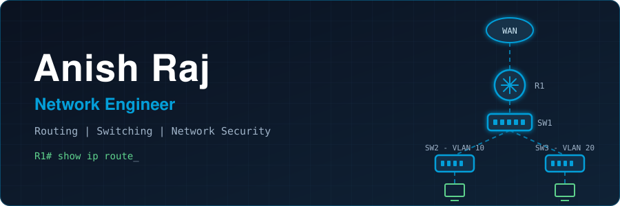

 

---

## 💫 About Me

I'm a network engineer focused on designing, configuring, securing, and troubleshooting computer networks.

My core strength is in routing and switching: subnetting, VLANs, inter-VLAN routing, IPv4/IPv6 addressing, and enterprise network design. I work hands-on with Cisco Packet Tracer and use Wireshark to analyze traffic and diagnose problems at the packet level.

I'm currently advancing through the CCNA curriculum, going deeper into routing protocols, network services, and enterprise architecture.

**🎯 Goal:** build a career as a network engineer and grow into network security.

---

## 🛠️ Skills

**Routing & Switching**

**Addressing & Protocols**

**Network Security**

**Tools & Platforms**

---

## 🎓 Certifications

| Certification | Issuer | Issued | Credential ID |
|---------------|--------|--------|---------------|
| **CCNA 200-301 Network Fundamentals** (course completion) | Simplilearn | Jun 2026 | `10301181` |
| **DROP Certified Security Course** | The Drop Organization | Feb 2025 | `DCSC-ARPR0924` |

---

## 📊 GitHub Stats

---

